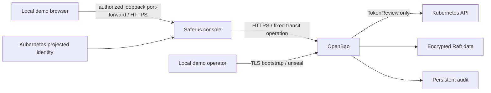

# Architecture

Agentless means applications call the vault HTTPS API directly. There is no
secrets injector, CSI driver or client sidecar. It does not remove application
responsibility for authentication, token lifetime, error handling or secret use.

The console exchanges its projected identity for a narrowly scoped token,
performs a fixed synthetic transit roundtrip and revokes that token. Only a
boolean result, algorithm name and initial TTL reach the browser. No user-supplied
message, ciphertext, token or stored secret crosses that interface.

The single-node Raft installation is deliberately local. A production design
must separately address availability, external custody, audit retention,
certificate rotation, backup restoration and capacity. Helm's desired state
does not itself prove these properties.

## AI-SDLC adoption boundary

The first proposed recipe changes only `web/static/ttl.js` and its behavioral
test. It improves human-readable token lifetime while preserving the received
numeric value and invalid-input behavior. The trusted verifier must independently
test it; candidate-authored tests alone cannot authorize promotion.

The desired outerloop builds the actual merged commit, verifies immutable
artifact identity and provenance, then promotes that same artifact into the
separate `ai-sdlc-production` test namespace. A fresh issue is the only external
trigger. Existing AI-SDLC Homedir-specific contracts still need explicit
adaptation; no permissive global repository substitution is acceptable.

This flow has not yet been demonstrated autonomously. The local installation
script is product bootstrap and validation tooling, not an AI-SDLC stage runner.
